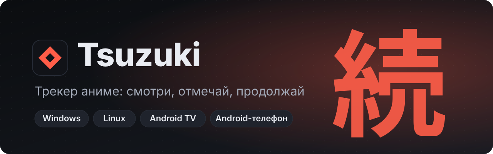

<p align="center">
  
</p>

<p align="center">
  <a href="https://github.com/Svinota2/Tsuzuki/releases/latest"></a>
  <a href="https://github.com/Svinota2/Tsuzuki/releases/latest"></a>
  <a href="https://github.com/Svinota2/Tsuzuki/releases/latest"></a>
  <a href="https://github.com/Svinota2/Tsuzuki/releases/latest"></a>
  <a href="https://shikimori.io"></a>
  <a href="https://t.me/TsuzukiAnime"></a>
</p>

<p align="center">
  <b>Каталог, трекер серий и встроенный плеер в одном приложении.<br>
  На компьютере, телевизоре и телефоне. Прогресс синхронизируется через Shikimori.</b>
</p>

<p align="center">
  <a href="https://github.com/Svinota2/Tsuzuki/releases/latest"><b>⬇&nbsp;&nbsp;Скачать Tsuzuki</b></a>
  &nbsp;·&nbsp; <a href="#-установка">Установка</a>
  &nbsp;·&nbsp; <a href="#-возможности">Возможности</a>
  &nbsp;·&nbsp; <a href="#-сборка">Сборка</a>
  &nbsp;·&nbsp; <a href="https://t.me/TsuzukiAnime">Новости</a>
</p>

---

## ✨ Главное

| | |
|:---:|---|
| 📚 | **Каталог** — поиск, постеры, описания, рейтинги и статистика Shikimori; сезоны одной франшизы склеены в одну карточку |
| ✅ | **Трекер** — «смотрю», «в планах», «просмотрено», «брошено», отметки серий, оценки, заметки и подборки |
| 🔄 | **Синхронизация с Shikimori** — вход через аккаунт, отметки и оценки уходят в обе стороны, работает офлайн |
| ▶️ | **Встроенный плеер** — досмотрел серию, и она отметилась сама; субтитры .srt и .ass |
| 📂 | **Автораскладка папки** — Tsuzuki сам находит тайтлы по названиям папок и понимает «2 сезон», «S2», «[группа] 1080p» |
| 📊 | **Статистика и итоги года** — часы, жанры, серии подряд, достижения и картинка для сторис |
| 🔔 | **Уведомления** — о новых сериях на ПК и на Android, даже когда приложение закрыто |
| 🎲 | **Рулетка и «Для тебя»** — случайный тайтл из списка и рекомендации по любимым жанрам и студиям |
| ⬆️ | **Автообновление** — в один клик, с проверкой файла по SHA-256 |
| 🎨 | **Темы** — тёмная, OLED, сине-серая и светлая; свой акцентный цвет, масштаб и размер карточек |

## ⬇ Скачать

Все файлы — на странице **[последнего релиза](https://github.com/Svinota2/Tsuzuki/releases/latest)**.

| Устройство | Файл |
|---|---|
| 💻 Windows 10/11 | `Tsuzuki-Setup.exe` — установщик, обновляется сам |
| 💻 Windows без установки | `Tsuzuki-win-x64.zip` |
| 🐧 Linux (Ubuntu, Debian, Mint) | `Tsuzuki-1.6.0-amd64.deb` |
| 🐧 Linux, любой дистрибутив | `Tsuzuki-1.6.0-linux-x64.tar.gz` |
| 📺 Android TV и приставки | `Tsuzuki-TV.apk` |
| 📱 Android-телефон | `Tsuzuki-Phone.apk` |

## 🛠 Установка

### Windows

1. Скачай `Tsuzuki-Setup.exe` и запусти.
2. Если Windows покажет «Система Windows защитила ваш компьютер», нажми **«Подробнее» → «Выполнить в любом случае»**.

> [!NOTE]
> Предупреждение SmartScreen появляется у всех новых программ без платной подписи кода. Проверить, что файл настоящий, можно по SHA-256 на странице релиза.

### Linux

```bash
sudo apt install ./Tsuzuki-1.6.0-amd64.deb        # Ubuntu, Debian, Mint
# или портативно:
tar xzf Tsuzuki-1.6.0-linux-x64.tar.gz   # затем chmod +x tsuzuki и ./tsuzuki
```

### Android TV и телефон

1. Скачай APK для своего устройства (на ТВ удобно через приложение-загрузчик или флешку).
2. Разреши установку из неизвестных источников, когда Android спросит.
3. Дальше Tsuzuki обновляется сам: кнопка **«Обновить»** скачает новую версию.

> [!IMPORTANT]
> На телевизор ставь `Tsuzuki-TV.apk`, на телефон — `Tsuzuki-Phone.apk`. У них разные раскладки интерфейса и разные каналы обновлений.

## 🚀 Возможности

**Библиотека и каталог**
- Сезоны и части франшизы в одной карточке, отдельный переключатель «OVA и спешлы»
- Чистый поиск без клипов и промо, сортировка «Лучшие» с учётом числа оценок
- Календарь онгоингов, история просмотра, «Продолжить просмотр»
- «Люди»: профили пользователей Shikimori, друзья, их оценки и активность
- Импорт списков из MyAnimeList, Shikimori, Kitsu (файл .xml) и AniList (по нику)

**Просмотр**
- Встроенный плеер для своих файлов с автоотметкой серий и субтитрами
- Автораскладка общей папки с аниме: таблица «папка → тайтл» с процентом уверенности, ничего не привязывается без подтверждения
- Кнопки официальных сервисов прямо на странице тайтла

**Статистика**
- Часы, серии, «дней подряд», сравнение твоих оценок с оценками Shikimori
- Итоги года: лучший месяц, любимые жанры, топ-5 постеров, картинка 1080×1920 и 1080×1080
- Достижения

**ПК**
- Трей, автозапуск, фоновые проверки новых серий с системными уведомлениями
- Автообновление: тихая установка и перезапуск, на Linux — ссылка на страницу релиза

**Android TV и телефон**
- Управление с пульта, крупный интерфейс для ТВ, отдельная раскладка для телефона
- Фоновые уведомления о новых сериях (раз в ~6 часов) и кнопка «Проверить сейчас»
- Обновление в одно касание с проверкой SHA-256

## 🧩 Как устроено

```
                ┌───────────────────────────────┐
                │  Интерфейс (HTML/CSS/JS)       │   tsuzuki-src/src/renderer
                │  каталог · трекер · плеер ·    │
                │  статистика · настройки        │
                └───────┬───────────────┬───────┘
                        │               │  sync-www.sh копирует интерфейс
          preload.js    │               │  в Android-проекты
                        ▼               ▼
        ┌──────────────────────┐   ┌──────────────────────────┐
        │  Electron (ПК)       │   │  Android WebView          │
        │  main.js, services.js│   │  NativeBridge.java        │
        │  трей, файлы, плеер, │   │  уведомления (WorkManager)│
        │  автообновление      │   │  установка APK            │
        └──────────┬───────────┘   └────────────┬─────────────┘
                   │                            │
                   ▼                            ▼
          ┌─────────────────────────────────────────────┐
          │  Shikimori API · GitHub Releases (version.json) │
          └─────────────────────────────────────────────┘
```

Данные библиотеки хранятся локально на устройстве. Наружу уходят только запросы к Shikimori, проверка обновлений на GitHub и, если ты сам разрешишь, анонимная статистика запусков. Подробно — в [политике конфиденциальности](docs/).

## 🔧 Сборка

**ПК (Electron 45):**
```bash
cd tsuzuki-src
npm install
npm start                  # запуск из исходников
npm run build:win          # установщик Windows
npm run build:linux        # deb и tar.gz
npm run release            # файлы релиза + version.json
```

**Android TV:**
```bash
cd tsuzuki-tv-src
./sync-www.sh              # копирует интерфейс из tsuzuki-src
./gradlew assembleRelease
```

**Android-телефон:**
```bash
cd tsuzuki-phone-src
./sync-www.sh ../tsuzuki-src ../tsuzuki-tv-src
./gradlew assembleRelease
```

**Релиз:** `node tools/make-release.mjs` в `tsuzuki-src` собирает файлы с постоянными именами, считает SHA-256 и пишет `version*.json` для автообновления.

> [!WARNING]
> Ключ подписи `tsuzuki.keystore` в репозитории не хранится. Положи его в `tsuzuki-tv-src/app/` и `tsuzuki-phone-src/app/` перед сборкой Android — без того же ключа обновление не встанет поверх установленной версии.

## 📁 Структура

```
Tsuzuki/
├── tsuzuki-src/            ПК: Electron (Windows, Linux) и общий интерфейс
│   ├── src/main/           главный процесс: окна, файлы, сервисы, обновления
│   ├── src/renderer/       интерфейс: views/, api/, components/, styles/
│   ├── tools/              установщик NSIS, make-release.mjs, тесты
│   └── CHANGES-*.md        что менялось в каждой версии
├── tsuzuki-tv-src/         Android TV: Java-мост, tv-web/, gradle
├── tsuzuki-phone-src/      Android-телефон: phone-web/phone.css, gradle
└── docs/                   история разработки, политика, инструкции
```

## 📜 Лицензия

Открытая лицензия пока не выбрана: все права принадлежат автору.

---

<p align="center">
  Сделано с любовью к аниме · <a href="https://t.me/TsuzukiAnime">t.me/TsuzukiAnime</a><br>
  <sub>続き (tsuzuki) — по-японски «продолжение»</sub>
</p>
